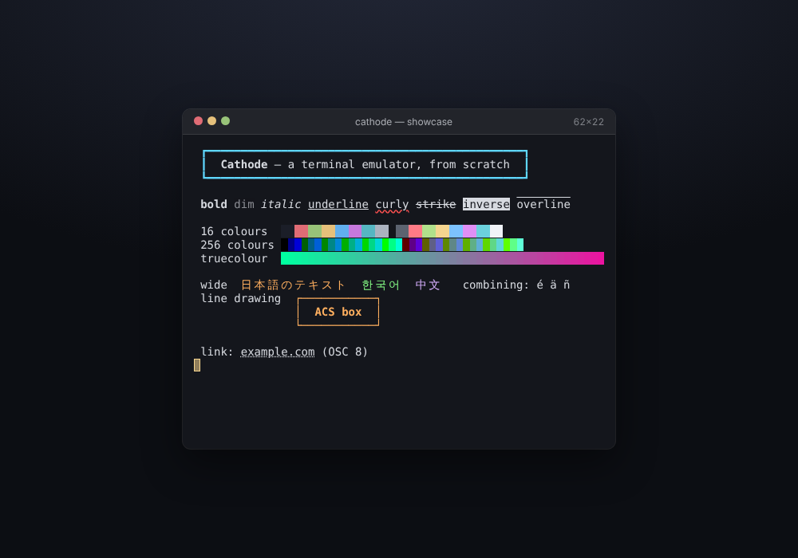

# Cathode

**A terminal emulator, built from scratch in Rust with zero dependencies.**
It spawns real programs (vim, nano, less, top, tmux…) on a real pseudo-terminal, parses their output with a
DEC-style escape-sequence state machine, maintains the screen they are drawing on, answers the questions they
ask the terminal, and renders the result as text, ANSI, HTML, SVG or JSON — or records it as an
[asciicast v2](https://docs.asciinema.org/manual/asciicast/v2/) and replays it in a self-contained HTML player.



*(`examples/showcase.png`, rendered by Cathode itself from `examples/showcase.sh`: SGR attributes, 16/256/true colour,
CJK double-width text, combining marks, DEC line drawing, an OSC 8 hyperlink.)*

## Run it

```bash
cargo build --release                      # no dependencies, ~3 s
alias cathode=./target/release/cathode

# run any program on a PTY, drive it with a key script, print the final screen
cathode run --keys 'ihello from cathode<Esc>:wq<CR>' -- vim -u NONE -N /tmp/hello.txt
cathode run --cols 100 --rows 30 --format html -o top.html -- top          # screenshot of top as HTML
cathode run --record demo.cast --keys '<until "~">:q<CR>' -- vim             # record a session
cathode replay demo.cast --player demo.html --idle-limit 1                   # self-contained HTML player
cathode feed --format json < some-escape-stream.bin                          # parse a raw byte stream
cathode tmux-diff --minimize stream.bin                                      # compare with real tmux
cathode keys '<C-x><S-Tab><F5><mouse press left 10,5>'                       # what bytes would be sent?

./verify.sh        # everything: 168 tests + a 32-check CLI demo + headless-Chromium checks
./demo.sh          # the CLI demo only (artifacts in ./out)
```

`cathode help` lists every option. Key-script syntax: literal text, plus `<Esc> <CR> <Tab> <BS> <Del> <Up> … <F12>`,
modifiers (`<C-x> <M-x> <S-Tab> <C-S-Up>`), `<lt>` for a literal `<`, `<wait 300>`, `<until "text">` (block until the
screen contains the text), `<resize 100x30>`, `<mouse press left 10,5>`, `<mouse wheel up 3,4>`, `<paste "text">`,
`<focus in>`.

## Features

**Required (all shipped, each covered by tests *and* the demo script)**

1. **VT parser** (`src/parser.rs`) — Paul Williams' DEC ANSI state machine: CSI / OSC / DCS / ESC, `;` parameters and `:`
   sub-parameters, private markers, intermediates, C0 controls executing inside sequences, CAN/SUB abort, ESC restart,
   SOS/PM/APC swallowed, size-capped strings, and an incremental UTF-8 decoder that survives any chunking (byte-at-a-time
   ≡ whole buffer is a test) and turns overlongs/surrogates/truncations into U+FFFD.
2. **Screen model** (`src/screen.rs`, `src/term.rs`) — cursor movement, erase (ED/EL/ECH), insert/delete (ICH/DCH/IL/DL),
   scroll regions (DECSTBM, SU/SD), tab stops, deferred-wrap ("last column") semantics, origin mode, insert/newline modes,
   save/restore cursor, DEC special graphics + UK charset (G0–G3, SO/SI), alternate screen (47/1047/1049), soft & hard
   reset, DECALN, double-width and combining characters (width tables generated from the Unicode DB), background-colour
   erase, 10 000-line scrollback.
3. **SGR / colours / OSC / replies** — all attributes and resets, 16 / 256 / truecolour in both `;` and `:` forms, underline
   styles and colours, OSC 0/2 titles, OSC 8 hyperlinks, OSC 4/10/11/104/110/111 palette get/set, and the answers a real
   terminal gives: CPR/DSR, DA1/DA2/DA3, XTVERSION, DECRQM, DECRQSS, XTWINOPS size reports. (OSC 52 clipboard access is
   deliberately *not* honoured.)
4. **Real PTY host** (`src/pty.rs`, `src/session.rs`) — `posix_openpt`/`ioctl`/`poll` bound by hand (no `libc` crate),
   child in its own session with a controlling terminal, `TERM=xterm-256color`, live resize with `SIGWINCH`, replies
   written back to the child, scripted input, `<until>` synchronisation, exit-status propagation, kill-on-drop, and a
   non-blocking write path that cannot deadlock on large pastes.
5. **Renderers** (`src/render.rs`) — plain text, ANSI (re-serialises to a stream that reproduces the screen cell for cell),
   self-contained HTML (dark/light/auto, hyperlinks restricted to safe schemes, escaped), SVG, JSON.

**Stretch (all four shipped)**

6. **asciicast v2** (`src/cast.rs`, `src/json.rs`) — record (with opt-in input recording and resize events), strict parser
   (monotonic time, bounded dimensions), replay to any timestamp, idle-time compression, real-time `--tty` playback, and an
   HTML player (pre-rendered, row-deduplicated frames + scrubber, play/pause, speed) with no external resources.
7. **Scrollback + reflow** — soft-wrapped lines are rejoined as logical lines and re-wrapped on width changes (wide
   characters never split, cursor follows its character, history respects the limit).
8. **tmux differential oracle** (`src/tmuxdiff.rs`) — feeds identical bytes to Cathode and a real tmux pane and compares the
   screens cell by cell, with a delta-debugging minimiser. ~1 400 generated streams and real vim/less/nano/top/ls output agree.
9. **Input encoder** (`src/input.rs`) — keys with modifiers and application-cursor mode, function keys, X10 / normal / button
   / any-motion mouse reporting in default, UTF-8, SGR and urxvt encodings, bracketed paste (with end-marker stripping) and
   focus events — verified against a real vim (a scripted click moves its cursor; a paste arrives).

## How it is verified

| Layer | What | Where |
|-------|------|-------|
| Unit / integration | 168 tests in 13 suites: parser (21), screen (41), pending-wrap (7), SGR/render (17), PTY with real vim/nano/less (15), cast (10), reflow (10), input (11), width (3), review regressions (9), fuzz (4), tmux oracle (15), tmux vs real programs (5) | `tests/` |
| Fuzz | 6 000+ structured streams with random resizes + 300 pure-random byte streams; grid invariants (no orphaned wide halves, cursor/region in bounds, every line `cols` wide) checked throughout, in debug (overflow-checked) and release | `tests/fuzz.rs` |
| Oracle | generated streams vs tmux (narrow + wide families, soakable with `CATHODE_ORACLE_OFFSET`), real programs vs tmux | `tests/tmux_oracle.rs`, `tests/tmux_programs.rs` |
| End to end | `demo.sh`: 32 checks through the CLI; `verify.sh` adds headless-Chromium rendering and player checks | `demo.sh`, `verify.sh`, `tools/*.js` |
| Adversarial | two written reviews, 22 findings (a PTY deadlock, double-spaced HTML, a notched `top` header, a width table that made 690 000 code points wide, …), each with a regression test | `REVIEW.md` |

### Known differences from tmux (deliberate — Cathode follows xterm)

The oracle is only useful if disagreements are understood, so each one is written down (details in `REVIEW.md` R-16…R-20):

| Behaviour | Cathode / xterm | tmux 3.4 |
|-----------|-----------------|----------|
| Background-colour erase on whole-line clears, wrap fillers, scrolled-in lines | applied | not applied |
| `IL`/`DL` with the cursor outside the scroll region | ignored | operates on the whole screen |
| `ICH` that would push text past the used part of the line | shifts | no-op |
| Overwrite / insert / delete into half of a wide char | blanks both halves | leaves an inconsistent grid |
| `BS`, `VPA`, `IND`/`NEL`/`RI`, autowrap-off + wide char in the deferred-wrap state | cursor is *on* the last column; movement ends the wrap | cursor is "at column `width`" |

(Where tmux and xterm agree — including the deferred-wrap behaviour of `EL`/`ED`/`ECH`/`DCH`, which the oracle showed
matters for ncurses full-width bars — Cathode matches both.)

## Layout

```
src/parser.rs  vt state machine + UTF-8      src/render.rs   text / ANSI / HTML / SVG / JSON
src/screen.rs  grid, cursor, modes, reflow   src/cast.rs     asciicast + HTML player
src/term.rs    dispatch, SGR, OSC, replies   src/json.rs     small JSON reader/writer
src/pty.rs     openpt/ioctl/poll FFI         src/input.rs    keys, mouse, paste, focus, script language
src/session.rs child + Term + recording      src/tmuxdiff.rs differential oracle + minimiser
src/width.rs   wcwidth (table generated by tools/gen_width.py from the Unicode database)
tests/         9 suites                      tools/          width generator, Playwright helpers
examples/      showcase.{sh,png,html,svg,cast} + player
```
~5 200 lines of library/CLI, ~2 000 lines of tests. Linux only (ioctl numbers); no third-party crates.

## Why I chose this today

Nothing in this repo's history touches the layer every one of its programs would run on: the terminal. Earlier builds
cover compilers, VMs, filesystems, TLS, DNS, a Game Boy — but none of them is the thing that turns a byte stream into a
screen. It is also one of the few systems where **correctness has a free, independent oracle** (tmux is itself a
terminal emulator) and **real programs make brutal acceptance tests** (vim, nano, less, top, tmux itself). That let the
project be driven by evidence rather than by my reading of a spec — the oracle caught three bugs I would not have found
by review (one of them visibly breaks `top`).

## Where a human could take this next

* **Keep going on the oracle**: add xterm's `vttest` / iTerm2's `esctest` corpora; compare against a second emulator
  (kitty or VTE headless) to resolve the xterm-vs-tmux differences instead of just documenting them.
* **A real front end**: the model is renderer-agnostic — put it behind a GPU text renderer, or WASM + `<canvas>`
  (the HTML/SVG renderers already show the layout), and add selection/copy, search through scrollback and URL detection.
* **Missing terminal features**: left/right margins (DECSLRM), sixel and the kitty graphics protocol, the kitty keyboard
  protocol, DECCOLM, grapheme clustering (ZWJ emoji sequences, VS16 widening), BiDi, an OSC 52 permission model.
* **Multiplexer**: panes/windows on top of `Session` — the `Term` + PTY pieces are exactly what tmux's core is.
* **Portability**: macOS/BSD `ioctl` constants and `forkpty`, a ConPTY backend for Windows.
* **Performance**: ~30 MB/s today; parameter parsing allocates per sequence — a fixed-array `Params` and a fast ASCII
  print path would be several times faster.
