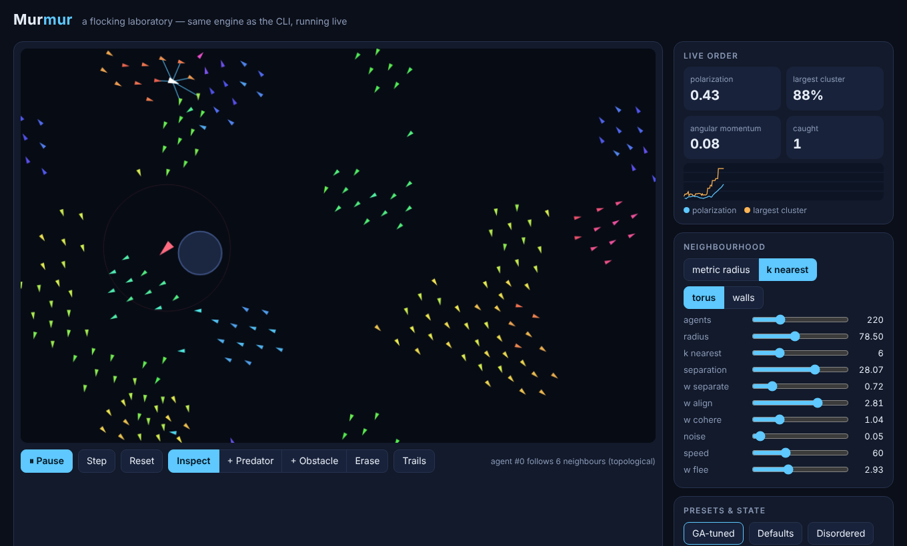

# Murmur — a flocking laboratory

A deterministic, seeded boids engine plus the instruments to treat flocking as a physical system: order parameters, a noise-driven phase-transition sweep, a metric-vs-topological neighbourhood comparison, predator/obstacle experiments, a genetic tuner, snapshot replay, and a live browser UI. Pure JavaScript, **zero dependencies**. One engine file (`engine.js`) runs identically in Node and in the browser.



## Run it

```bash
node murmur.js help                       # all commands
open index.html                           # live UI (no server needed)
node --test test/engine.test.js test/tools.test.js test/cli.test.js
./demo.sh                                 # 14-check end-to-end run (incl. headless-browser UI test)
```

| command | what it does |
|---|---|
| `run --n 200 --steps 600 --mode topological --predators 1 --snapshot s.json` | simulate, print metrics table + state hash |
| `sweep --out results` | noise → polarization curve (CSV + SVG): the order→disorder transition |
| `compare --ns 60,120,240,480` | metric radius vs k-nearest across densities, paired seeds, ±std |
| `hunt --n 150 --predators 2` | predator catch-rate experiment |
| `tune --gens 8 --pop 14` | genetic tuner; reports held-out-seed generalisation |
| `bench --n 2000` | spatial hash vs brute force (+ exactness check) |
| `replay --snapshot s.json --steps 60 --expect <hash>` | resume a snapshot bit-exactly and verify the hash |

Every engine parameter (`--radius --k --sepR --wSep --wAli --wCoh --noise --boundary --constSpeed …`) can be passed to the commands. Unknown or malformed options are rejected, not ignored.

## Features

**Required**
1. **Seeded boids engine** — separation / alignment / cohesion, torus and walled worlds, uniform-grid spatial hash (counting-sort build, wrap-aware), proven equal to brute force across world shapes; synchronous update; full-state FNV hash for determinism.
2. **Neighbourhood modes** — metric radius vs *topological* k-nearest, with an exact kNN by ring expansion that handles torus wrap and ties (tie-break by index) and is verified against brute force.
3. **Instruments** — polarization, angular momentum, mean NN distance, union-find cluster count / largest fraction, close pairs; noise sweep and density comparison tools that emit CSV + SVG.
4. **Predators & obstacles** — lead-pursuit predators with turn-rate limit, catch + respawn + cooldown, prey flee force, circular pillars with steer-around plus a hard no-penetration constraint.

**Stretch (all shipped)**
5. **Genetic tuner** — (μ+λ) GA with tournament selection, blend crossover, mutation and elitism over 7 genes; fitness mixes polarization, cohesion, collisions and catches. Checked on seeds it never trained on.
6. **Snapshot / replay** — JSON snapshot with strict validation; restore continues bit-identically (hash verified).
7. **Browser UI** — canvas flock coloured by heading, live sliders, drop predators/pillars, trails, click an agent to *see* its neighbours (radius circle or k links), live polarization/cluster sparkline, save/load snapshots, GA-tuned preset.

## What it found (actual runs, `results/`)

- **Phase transition:** with a constant-speed 200-agent flock, polarization sits at ~0.8 up to noise σ≈0.1 rad/step, then collapses (0.33 at 0.15, 0.13 at 0.2, ≈0.07 beyond). `results/sweep.svg`.
- **Metric vs topological — an honest, mixed result.** At N=480 (dense) the 7-nearest flock merges into a single group (largest cluster 0.97 ± 0.03 vs metric 0.74 ± 0.14). At moderate N, k-nearest flocks form several sub-flocks of roughly k+1 agents, so it was *not* uniformly more cohesive, and polarization was often lower. Noise between seeds is large (±0.1–0.18), so I would not claim the starling result is reproduced from this; the tool is there to dig further. Caveat: cluster size uses a fixed absolute link radius, so very sparse flocks look fragmented regardless of rule.
- **Tuner:** defaults score 0.70 (training seeds) / 1.08 (held-out); the evolved genes (`wAli≈2.8, radius≈78, sepR≈28, k=6, wFlee≈2.9`) score 1.74 / 1.63. The result is mostly "align harder, see further, avoid more", which is plausible behaviour for the fitness used.
- **Speed:** 3000 agents ≈ 10 ms/step (metric), 14 ms (k-nearest); grid radius queries ~13× faster than brute force at N=2000.

## Layout

`engine.js` engine + metrics · `tools.js` experiments, GA, SVG · `murmur.js` CLI · `index.html` UI · `test/` · `demo.sh` · `PLAN.md` · `REVIEW.md` (adversarial review: 8 issues found and fixed) · `results/` generated plots and CSVs.

## Why this today

The ledger is full of compilers, protocols, codecs and solvers, but had no collective-motion or agent-based-simulation build. Flocking looks like a toy until you measure it, and measuring it (order parameters, sweeps, held-out validation) is where it became interesting. The neighbourhood experiment came back inconclusive, which is the more honest thing to ship than a flattering plot.

## Where a human could take this next

- 3D flocks and a vision-cone (blind-angle) model; true Vicsek variants with vector vs scalar noise for the first- vs second-order transition debate.
- Control the link-radius confound (scale by mean spacing) and run many more seeds to settle the metric/topological question; add finite-size scaling and susceptibility peaks to locate the critical noise.
- Multi-objective GA (Pareto front of cohesion vs predator survival); coevolve the predator's strategy.
- Cut per-pair allocations in the hot loop and move to typed neighbour lists / WebWorker to push the UI to tens of thousands of agents.
